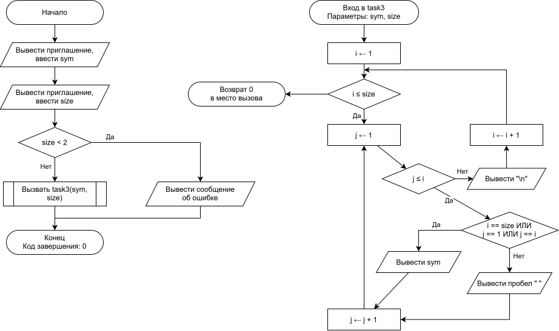

# Домашнее задание

## Условие задачи


---

## 1. Алгоритм и блок-схема

### Алгоритм


### Блок-схема

[]()
## 2. Реализация программы
```c

```
## 3. Результат работы программы

## 4. Информация о разработчике
Гаврилова Анна, бИД-262
